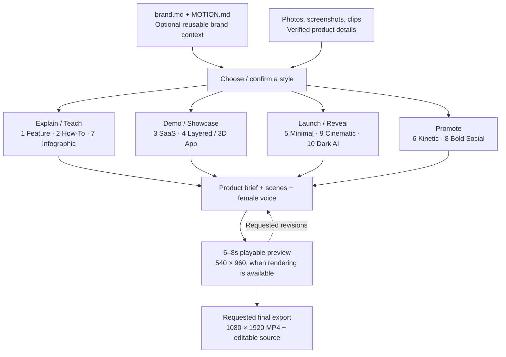

# Product Motion Graphics

**One Claude skill with 10 selectable styles** for vertical product and app videos on YouTube Shorts. Work with product photos, app screenshots, video clips, or a combination of these assets.

## Start here: one prompt

Once the skill is available, provide your actual assets with this prompt. Preview generation time depends on the available rendering and audio tools.

```text
Use the Product Motion Graphics skill to create a 30-second YouTube Short
explaining an AmezPrice feature from the supplied screenshots.
First, show suitable styles and ask me to confirm my selection.
Then provide only a 6–8 second preview with natural female English narration.
Preserve the real UI, labels, and data. Report any missing assets or audio tools.
```

Describe the changes you want to revise a preview:

- "Slow down the zoom in the second scene and give viewers more time to read the UI."
- "Replace the headline with my supplied text and retain the other approved scenes."
- "Use my supplied brand colors without changing the colors inside the app screenshot."
- "Fix the female narrator's pronunciation and align the captions with the revised audio."
- "Try a new hook in the selected style while preserving the tutorial's actual steps."

These quick-start and revision prompts are ready to copy in [start-here](prompts/start-here.md).

## How they fit together

Set up brand context once and reuse it across videos. The output project's `brand.md` records the product, audience, approved claims, and asset sources. Its `MOTION.md` records colors, typography, motion, voice, and layout preferences. Reuse these files when they already exist. Setup is optional: establish missing information from the supplied assets and brief rather than guessing and calling the result on-brand.

All styles read the same brand context. Brand context does not select a style: **you confirm the style for each new video**, then that context informs the scenes, narration, and preview. See [brand setup](references/brand-setup.md) for setup instructions and an optional read-first snippet for project instructions.



For a preview-only request or an explicitly requested review, stop at that point. If the full video is already requested, production can continue to final export after any required feedback. Runtime and audio requirements are listed below.

## Styles: what you get and what to say

| Stage | Style | What you get | Say this |
| --- | --- | --- | --- |
| Explain | **1. [Screenshot / Feature Explainer](styles/screenshot-feature-explainer/STYLE.md)** | Readable zooms, focus highlights, and callouts on real app screenshots to explain a feature's meaning and benefit. | "Create a 30-second Short explaining AmezPrice's price-history feature from these screenshots. Use Style 1 with female English narration." |
| Teach | **2. [Guided / How-To Tutorial](styles/guided-how-to/STYLE.md)** | Verified screen order, numbered steps, accurate tap cues, and a visible result so viewers can repeat an app task. | "Use these ordered screenshots and recording to teach viewers how to set an AmezPrice price alert. Create a step-by-step Short in Style 2." |
| Demo | **3. [SaaS / Product Demo](styles/saas-product-demo/STYLE.md)** | Focused UI animations, feature highlights, and clear action/result scenes for app or software demonstrations. | "Create a demo of my app's three main features from these screenshots and recording. Use Style 3." |
| Showcase | **4. [Layered / 3D App Showcase](styles/layered-app-showcase/STYLE.md)** | Floating UI cards, layered depth, and a readable feature hero; the owner's preferred promo direction for AmezPrice. | "Create an AmezPrice promo with floating cards and depth from these screenshots. Use Style 4 and keep the real UI readable." |
| Launch | **5. [Minimal / Apple-inspired](styles/minimal-apple/STYLE.md)** | Clean typography, spacious layouts, and smooth movement for a premium product presentation. | "Create a clean, premium launch Short from these product images. Use Style 5 with concise copy and smooth movement." |
| Promote | **6. [Kinetic Typography](styles/kinetic-typography/STYLE.md)** | Text timed to speech or available musical accents for energetic hooks and benefit-led messaging. | "Animate this product copy and these photos in Style 6. Present the main benefits as moving text with female narration." |
| Explain | **7. [Infographic / Explainer](styles/infographic-explainer/STYLE.md)** | Charts, icons, diagrams, and comparisons that clarify supplied numbers and supported claims. | "Explain this feature comparison using my supplied numbers and screenshots. Use Style 7 and preserve the exact values." |
| Promote | **8. [Bold Social Media](styles/bold-social-media/STYLE.md)** | Bright colors, large hooks, and fast product cuts for attention-grabbing Shorts and offers. | "Create an energetic Short from these product photos and approved offer details. Use Style 8 with bold text and fast cuts." |
| Reveal | **9. [Cinematic / Futuristic](styles/cinematic-futuristic/STYLE.md)** | Dramatic lighting, glow, depth, and product-detail reveals adapted to the available assets. | "Create a dramatic product reveal from these gadget photos and clips. Use Style 9 with a focus on lighting and depth." |
| Launch | **10. [Dark / AI Product Launch](styles/dark-ai-launch/STYLE.md)** | A dark interface stage, selective edge highlights, and text bridges for AI or software feature launches. | "Create a dark software launch Short from these screens. Use Style 10 with readable UI and a feature-to-result story." |

The [style menu](styles/INDEX.md) is the source of truth for numbering and available options. All choices are styles within this one skill. Stage labels describe common uses; adapt the format to the actual task.

## Workflow: from idea to final video

| Stage | Capability | What you get | Say this |
| --- | --- | --- | --- |
| Set up | [Product and brand inputs](references/production.md) | Inspection of supplied logos, colors, screenshots, photos, clips, and verified product details, with missing essentials identified. | "Here are AmezPrice's logo, screenshots, and brand colors. Use them to plan a Short." |
| Plan | [Product brief](templates/product-brief.json) | A working brief covering the product, audience, purpose, duration, supported benefits, CTA, language, and voice source. Story and scene design follow style selection. | "Explain this feature to new users in a 30-second English Short. Here are the screenshots and verified details." |
| Learn | [Reference analysis](references/reference-learning.md) | Evidence notes from accessible video or frames, improvements to a matching style, or a new style for a distinct visual language. | "Improve this skill from this reference video. Add useful techniques to a matching style, or create a new style if its visual language is distinct." |
| Choose | [Style selection](styles/INDEX.md) | Numbered options and purpose-based recommendations, with user confirmation before each new video's preview. | "I want to explain a feature from these screenshots. Show suitable styles so I can select one." |
| Preview | [Animated preview](references/rendering.md) | A 6–8 second playable sample at 540 × 960 when rendering tools are available, with a female voice sample when available. | "The style is confirmed. Provide only a short preview first, then revise it based on my feedback." |
| Finish | [Final export](references/rendering.md) | A 1080 × 1920 MP4, editable source, and any produced caption and voiceover files when rendering and required audio are available. | "Complete this preview as a 30-second YouTube Short with captions and female narration. Include the editable source." |

Reference learning and skill edits do not require video style selection. For a new video, Claude asks you to select or confirm a style before creating its visual preview. The confirmation requirement also applies when an example prompt names a style.

## Use it: describe what you want

These request examples route to modes or styles within this skill.

```text
"Set up my product brand"             → Reusable brand and motion context
"Brief this product Short"            → Product brief and, after selection, scene plan
"Explain this app feature"            → Recommend 1 · Feature Explainer; ask for selection
"Show how to set a price alert"       → Recommend 2 · How-To; verify the supplied steps
"Demo my app's main features"         → Recommend 3 · SaaS / Product Demo
"Make a floating-card app promo"      → Recommend 4 · Layered / 3D App Showcase
"Make a clean premium product launch" → Recommend 5 · Minimal / Apple-inspired
"Animate these benefit lines"         → Recommend 6 · Kinetic Typography
"Explain this chart with my numbers"  → Recommend 7 · Infographic / Explainer
"Make an energetic product offer"    → Recommend 8 · Bold Social Media
"Give this gadget a dramatic reveal"  → Recommend 9 · Cinematic / Futuristic
"Make a dark software launch"         → Recommend 10 · Dark / AI Product Launch
"Learn from this reference video"     → Improve a matching style or add an evidenced new one
"Polish this approved preview"        → Revise the current selected style
"Export this project as a Short"      → Finish the current project at the requested settings
```

A recommendation still requires your selection. Revisions retain the current video's selected style; each new video requires fresh confirmation.

## Prompts: ready to copy

Each file explains when to use its prompts. Add your actual assets, verified details, and requested changes. These are prompt helpers; no separate skills need to be installed.

| File | What is in it |
| --- | --- |
| [start-here.md](prompts/start-here.md) | A one-line starter, asset handoff, describe-an-edit examples, and a prompt to move from preview to final export. |
| [brand-design-system.md](prompts/brand-design-system.md) | Product and brand intake, reusable brand and motion profiles, and an optional read-first snippet for project instructions. |
| [briefs.md](prompts/briefs.md) | A product brief prompt, AmezPrice feature explainer and verified how-to examples, and scene-plan fields. |
| [polish.md](prompts/polish.md) | A motion/readability audit, real UI integrity checks, voice/caption fixes, and a fix-one-thing prompt. |
| [effects.md](prompts/effects.md) | 16 original effect prompts covering focus zooms, callouts, tap cues, floating cards, text, chart reveals, depth, and CTAs. |

## Quick choices for AmezPrice

- **Explain what a feature does and why it is useful:** Style **1**.
- **Teach viewers how to complete an app task:** Style **2**, with a verified screen sequence.
- **Demonstrate the UI or main features:** Style **3**.
- **Create a floating-card app promo:** Style **4**, the owner's primary visual preference.

Follow [the AmezPrice profile](references/products/amezprice.md) for product facts and reference priorities. Preserve real screenshot labels, data, and navigation; do not invent missing screens or results.

## Inputs, creativity, voice, and output

| Topic | Behavior |
| --- | --- |
| Images only | Animate product photos or screenshots using motion, crops, text, and callouts. A single screenshot does not establish unseen screens or actions. |
| Video only | Build a product story from supplied clips or recordings with editing, text overlays, and feature highlights. |
| Images + video | Combine both within one story, while distinguishing style references from assets intended to appear in the final video. |
| Creativity | A style is not an identical template for every video. Adapt hooks, layouts, crops, and transitions to the actual assets and purpose. Request an exact repeat or consistent series layout when needed. Preserve the real action order in tutorials. |
| Mixed style | On request, borrow a suitable secondary element while retaining an explicit primary style. Do not automatically mix all styles. |
| Female voice | Prefer a supplied real human female recording. Otherwise, use available natural female AI TTS and identify it as AI-generated. A real human requirement needs an actual recording. |
| Language | Use English by default. Use another language for a specific video only when explicitly requested. |
| Final format | Default: 1080 × 1920, 9:16, 30 fps, and 30 seconds unless requested otherwise. |
| Preview | Default: 6–8 seconds at 540 × 960, delivered as an actual playable file with any missing audio disclosed. |

The package includes skill instructions and a checking helper. It does not bundle a renderer, TTS service, credentials, or production media. If required tools are unavailable, Claude provides clearly labeled source or storyboard material and identifies what remains pending rather than claiming a completed render or voice track.

## What this skill needs to run

<details>
<summary>Inputs and tools, by job</summary>

| Job | Inputs / requirements | If missing |
| --- | --- | --- |
| Brand setup | Available logo, brand color/type guidance, product details, and asset sources. | Reuse supplied material and mark unknown tokens as pending. |
| Feature explainer — Style 1 | Readable app screenshots, supported feature meaning, and the intended benefit. | Identify unreadable details or unsupported behavior rather than inventing them. |
| How-to — Style 2 | Verified ordered screenshots or recordings, actual actions, and a visible result. | Plan only documented steps and identify missing actions or results. |
| App demo/showcase — Styles 3, 4, 10 | Real UI assets or recordings, verified features, and brand context when available. | Label mockups as illustrative; do not treat them as proof of actual product behavior. |
| Physical product — Styles 5, 8, 9 | Usable product photos or clips, real labels, and approved claims or offer details. | Do not invent unseen angles, packaging, or specifications. |
| Text / data — Styles 6, 7 | Approved copy and exact chart values, labels, units, and time ranges. | Request the data or omit the chart; do not use guessed values in the final video. |
| Playable preview / MP4 | An available renderer and its required runtime, assets, and fonts in the output project. Reuse a suitable existing renderer; see [the rendering guide](references/rendering.md) for a code-based example. | Clearly label source or storyboard deliverables and report MP4 rendering as pending. |
| Female narration | A human recording or a configured female TTS tool that supports the requested language. | Prepare the script, disclose silent previews, and keep narration pending. |
| Metadata validation | Python 3 and `ffprobe` on PATH to run the bundled checker. | Report the check as unrun rather than passed. |

Check installation commands and versions against the target project's actual tools. Do not save credentials in prompt files or the skill archive.

</details>

<details>
<summary>House rules every style follows</summary>

- The user selects or confirms a style for each new video. Library edits and reference study do not require a video preview.
- Default to vertical 9:16 product composition with readable UI, captions, and one clear visual focus.
- Keep the selected style recognizable while adapting hooks and scenes creatively to the assets and purpose.
- Preserve real product identity, screenshot labels, chart values, and tutorial action order.
- Read supplied brand context, apply explicit current instructions, and avoid guessing unknown brand details.
- Align timing and captions with actual narration. Do not call AI TTS a human recording.
- Preserve reference evidence limits: static frames cannot establish exact easing, beat synchronization, or voice quality.
- Deliver actual files and report render, audio, and verification status accurately. Publish only when requested.

</details>

<details>
<summary>Pairs well with: restrained motion and real UI</summary>

For a selected minimal treatment, use clear type hierarchy, restrained movement, and readable holds. Preserve the brief's intended energy in bold or kinetic styles rather than imposing minimal rules on every style.

Preserve app screenshots as original assets and animate highlight or label layers separately. Reuse existing real UI components for exact states when available. Do not describe controls automatically recreated from a screenshot as an accurate app implementation. See [screenshot production](references/screenshot-videos.md) for crop and coordinate guidance.

</details>

> **Honest limits:** Code can animate typography, UI, and graphics. Photoreal human footage, unseen product views, or accurate 3D geometry require suitable source assets or additional generation/modeling tools. This skill does not bundle those tools, a human voice artist, or a rendering service.

## Improve this skill

When sharing a reference, explain which part works well, include timestamps when available, identify the relevant product or style, and state its priority. Useful variations improve a matching style; a distinct visual language can become a new style within this skill. Evidence and access limits are recorded too. See [reference learning](references/reference-learning.md) and [studied batches](references/video-studies/INDEX.md).

## Use in Claude

[SKILL.md](SKILL.md) is the entry point. For Claude Code, name the folder `product-motion-graphics` and place it under the project's `.claude/skills/` or your personal `~/.claude/skills/`. Keep all styles, references, templates, and scripts together. Invoke `/product-motion-graphics` or describe a matching product-video task.

Simple starting prompt:

> "Use the Product Motion Graphics skill to explain a feature from AmezPrice screenshots. Show the styles and ask for my selection before creating a preview. Use English and a natural female voice."
