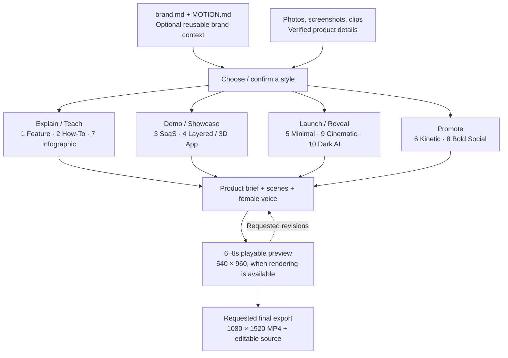

# Product Motion Graphics

Products aur apps ke liye vertical YouTube Shorts banane ka **ek Claude skill, 10 selectable styles ke saath**. Product photos, app screenshots, video clips, ya in sabka mix use kar sakte ho.

## Start here: ek prompt

Skill available ho to apne actual assets ke saath ye prompt do. Preview banne ka time rendering aur audio tools par depend karega.

```text
Product Motion Graphics skill use karo. AmezPrice ke diye hue screenshots se
30-second YouTube Short banana hai. Feature ko clearly explain karo.
Pehle suitable styles dikhao aur mujhse style confirm karwao.
Uske baad pehle sirf 6–8 second preview do, natural female Hinglish voice ke saath.
Real UI, labels aur data preserve karo. Missing assets ya audio tools ho to batao.
```

Preview ko describe karke edit karwa sakte ho:

- "Second scene ka zoom slow karo; UI padhne ka time badhao."
- "Headline ko mere is text se replace karo; baaki approved scenes same rakho."
- "Mere supplied brand colors use karo; app screenshot ke colors mat badlo."
- "Female voice ki pronunciation fix karo aur captions uske saath align karo."
- "Isi selected style mein naya hook try karo; tutorial ke actual steps same rakho."

Ye quick-start aur edit prompts [start-here](prompts/start-here.md) mein ready to copy hain.

## How they fit together

Brand details ek baar set up kar sakte ho. Output project ke `brand.md` mein product, audience, approved claims aur asset sources rahenge; `MOTION.md` mein colors, type, motion, voice aur layout preferences. Files pehle se hon to unhe reuse karo. Setup optional hai; missing information ko supplied assets aur brief se establish karo, guess karke result ko on-brand mat bolo.

Sabhi styles shared brand context padhte hain. Brand context style select nahi karta: **har naye video ka style aap confirm karoge**, phir usi context se scenes, voice aur preview banenge. Setup instructions [brand setup](references/brand-setup.md) mein hain; project instructions ke liye optional read-first snippet bhi diya hai.



Preview-only request ho ya aapne review manga ho to us point par stop hoga. Full video already requested ho to required feedback apply karke final export complete ho sakta hai. Runtime aur audio availability ki detail neeche hai.

## Styles: what you get and what to say

| Stage | Style | What you get | Say this |
| --- | --- | --- | --- |
| Explain | **1. [Screenshot / Feature Explainer](styles/screenshot-feature-explainer/STYLE.md)** | Actual app screenshot par readable zoom, focus highlight aur callout; feature ka meaning aur benefit samjhata hai. | "AmezPrice ke in screenshots se price-history feature explain karne ka 30-second Short banao. Style 1 chahiye, Hinglish female voice ke saath." |
| Teach | **2. [Guided / How-To Tutorial](styles/guided-how-to/STYLE.md)** | Verified screen order, step numbers, accurate tap cues aur visible result; viewer app task follow kar sakta hai. | "In ordered screenshots aur recording se AmezPrice mein price alert set karna sikhao. Style 2 mein step-by-step Short chahiye." |
| Demo | **3. [SaaS / Product Demo](styles/saas-product-demo/STYLE.md)** | Focused UI animations, feature highlights aur clear action/result scenes; app ya software ka demo. | "Mere app ke in screenshots aur recording se 3 main features ka demo banao. Style 3 use karo." |
| Showcase | **4. [Layered / 3D App Showcase](styles/layered-app-showcase/STYLE.md)** | Floating UI cards, layered depth aur readable feature hero; AmezPrice ke liye preferred promo direction. | "AmezPrice ke screenshots se floating cards aur depth wala app promo banao. Style 4 chahiye; actual UI readable rakhna." |
| Launch | **5. [Minimal / Apple-inspired](styles/minimal-apple/STYLE.md)** | Clean typography, spacious layouts aur smooth movement; premium product presentation. | "In product images se clean, premium launch Short banao. Style 5, short copy aur smooth movement chahiye." |
| Promote | **6. [Kinetic Typography](styles/kinetic-typography/STYLE.md)** | Speech ya available music ke accents ke saath moving text; energetic hooks aur benefit-led messaging. | "Is product copy aur photos ko Style 6 mein animate karo. Main benefits moving text mein dikhao, female narration ke saath." |
| Explain | **7. [Infographic / Explainer](styles/infographic-explainer/STYLE.md)** | Charts, icons, diagrams aur comparisons; supplied numbers aur supported claims ko clear banata hai. | "Mere diye hue numbers aur screenshots se feature comparison explain karo. Style 7 chahiye; values exactly same rakhna." |
| Promote | **8. [Bold Social Media](styles/bold-social-media/STYLE.md)** | Bright colors, large hooks aur fast product cuts; attention-grabbing Shorts aur offers. | "In product photos aur approved offer details se energetic Short banao. Style 8, bold text aur fast cuts chahiye." |
| Reveal | **9. [Cinematic / Futuristic](styles/cinematic-futuristic/STYLE.md)** | Dramatic lighting, glow, depth aur product-detail reveals; available assets ke hisaab se cinematic treatment. | "In gadget photos aur clips se dramatic product reveal banao. Style 9, lighting aur depth par focus karo." |
| Launch | **10. [Dark / AI Product Launch](styles/dark-ai-launch/STYLE.md)** | Dark interface stage, selective edge highlights aur text bridges; AI/software feature launch. | "Mere software ki in screens se dark launch Short banao. Style 10, readable UI aur feature-to-result story chahiye." |

Numbering aur current options ke liye [style menu](styles/INDEX.md) source of truth hai. Ye sab isi skill ke styles hain. Stage labels unke common uses dikhate hain; zarurat ke hisaab se format adapt ho sakta hai.

## Workflow: idea se final video tak

| Stage | Capability | What you get | Say this |
| --- | --- | --- | --- |
| Set up | [Product and brand inputs](references/production.md) | Supplied logo, colors, screenshots, photos, clips aur verified product details ki checking; missing essentials identify hote hain. | "Ye AmezPrice ka logo, screenshots aur brand colors hain. Inhe use karke Short plan karna hai." |
| Plan | [Product brief](templates/product-brief.json) | Product, audience, purpose, duration, supported benefits, CTA, language aur voice source ka working brief. Style select hone ke baad story aur scene plan banta hai. | "Goal feature samjhana hai, audience new users hain, 30 seconds aur Hinglish chahiye. Ye screenshots aur verified details hain." |
| Learn | [Reference analysis](references/reference-learning.md) | Accessible video/frames se useful techniques ki evidence note; matching style improve hota hai, ya distinct visual language ke liye naya style add hota hai. | "Is reference video se skill improve karo. Existing style se match ho to uski useful techniques add karo; alag ho to new style banao." |
| Choose | [Style selection](styles/INDEX.md) | Numbered options aur purpose-based recommendation; har naye video ke preview se pehle user ka style confirmation. | "Mere screenshots se feature explain karna hai. Suitable styles dikhao; main select karunga." |
| Preview | [Animated preview](references/rendering.md) | Render tools available hone par 6–8 second, 540 × 960 playable sample; available female voice sample ke saath. | "Style confirm hai. Pehle sirf short preview do, phir mere feedback par revise karna." |
| Finish | [Final export](references/rendering.md) | Render aur required audio available hone par 1080 × 1920 MP4, editable source, aur produced captions/voiceover files. | "Is preview ko full 30-second YouTube Short mein complete karo, captions aur female voice ke saath. Editable source bhi dena." |

Reference learning ya skill edit ke liye video style select karna zaroori nahi. Naya video banate waqt Claude pehle style select/confirm karwayega, uske baad visual preview banayega. Example prompt mein style likha ho tab bhi confirmation gate apply hota hai.

## Use it: bolo kya banana hai

Ye request examples hain; sab isi skill ke modes ya styles ko point karte hain.

```text
"Set up my product brand"             → Reusable brand and motion context
"Brief this product Short"            → Product brief and, after selection, scene plan
"Explain this app feature"            → Recommend 1 · Feature Explainer; ask for selection
"Show how to set a price alert"       → Recommend 2 · How-To; verify the supplied steps
"Demo my app's main features"         → Recommend 3 · SaaS / Product Demo
"Make a floating-card app promo"      → Recommend 4 · Layered / 3D App Showcase
"Make a clean premium product launch" → Recommend 5 · Minimal / Apple-inspired
"Animate these benefit lines"         → Recommend 6 · Kinetic Typography
"Explain this chart with my numbers"  → Recommend 7 · Infographic / Explainer
"Make an energetic product offer"    → Recommend 8 · Bold Social Media
"Give this gadget a dramatic reveal"  → Recommend 9 · Cinematic / Futuristic
"Make a dark software launch"         → Recommend 10 · Dark / AI Product Launch
"Learn from this reference video"     → Improve a matching style or add an evidenced new one
"Polish this approved preview"        → Revise the current selected style
"Export this project as a Short"      → Finish the current project at the requested settings
```

Recommendation ke baad selection zaroori hai. Current video's revision apna selected style retain karti hai; naye video ke liye fresh confirmation hota hai.

## Prompts: ready to copy

Har file mein us job ke liye prompt aur use karne ka point diya hai. Apne assets, verified details aur requested changes add karo. Ye prompt helpers hain; alag skills install karne ki zaroorat nahi.

| File | What is in it |
| --- | --- |
| [start-here.md](prompts/start-here.md) | One-line starter, asset handoff, describe-an-edit examples, aur preview se final export ka prompt. |
| [brand-design-system.md](prompts/brand-design-system.md) | Product/brand intake, reusable brand and motion profiles, aur project instructions ka optional read-first snippet. |
| [briefs.md](prompts/briefs.md) | Product brief prompt; AmezPrice feature explainer aur verified how-to ke examples; scene-plan fields. |
| [polish.md](prompts/polish.md) | Selected style ka motion/readability audit, real UI integrity check, voice/caption fixes, aur fix-one-thing prompt. |
| [effects.md](prompts/effects.md) | 16 original effect prompts: focus zoom, callout, tap cue, floating cards, text, chart reveal, depth aur CTA. |

## AmezPrice ke liye quick choice

- **Feature kya karta hai aur kyon useful hai:** Style **1**.
- **App mein koi task kaise karna hai:** Style **2**, verified screen sequence ke saath.
- **General UI / feature demo:** Style **3**.
- **Floating-card app promo:** Style **4**, owner's primary visual preference.

Product facts aur reference priorities ke liye [AmezPrice profile](references/products/amezprice.md) follow karo. Real screenshots ke labels, data aur navigation ko preserve karo; missing screens ya results invent nahi karne hain.

## Inputs, creativity, voice and output

| Topic | Behavior |
| --- | --- |
| Images only | Product photos ya screenshots se motion, crops, text aur callouts ban sakte hain. Ek screenshot se unseen screens ya actions establish nahi hote. |
| Video only | Supplied clips/recordings se product story, editing, text overlays aur feature highlights ban sakte hain. |
| Images + video | Dono ko ek story mein combine kar sakte hain; reference media aur final video mein dikhne wale assets ka role clear rahega. |
| Creativity | Same style har baar identical template nahi banata. Actual assets aur purpose ke hisaab se hook, layout, crops aur transitions adapt honge. Exact repeat ya consistent series layout chahiye to prompt mein bolo. Tutorial ki real step order preserve hogi. |
| Mixed style | User request par primary style ke saath suitable secondary element borrow kar sakte hain. Sab styles automatically mix nahi honge. |
| Female voice | Supplied real human female recording preferred hai. Otherwise available natural female AI TTS ko clearly AI-generated bataya jayega. Actual human required ho to recording chahiye. |
| Language | User ki language follow hogi; is workflow mein Hindi/Hinglish default preference hai. |
| Final format | Default 1080 × 1920, 9:16, 30 fps; duration 30 seconds unless requested otherwise. |
| Preview | Default 6–8 seconds at 540 × 960; actual generated playable file, with missing audio disclosed. |

Skill instructions aur checking helper included hain. Renderer, TTS service, credentials aur production media bundled nahi hain. Required tools unavailable hon to Claude source/storyboard aur pending requirements clearly batayega; render ya voice complete hone ka claim nahi karega.

## What this skill needs to run

<details>
<summary>Inputs and tools, by job</summary>

| Job | Inputs / requirements | Agar missing ho |
| --- | --- | --- |
| Brand setup | Available logo, brand colors/type guidance, product details aur asset sources. | Supplied material reuse karo; unknown tokens pending mark karo. |
| Feature explainer — Style 1 | Readable app screenshot(s), supported feature meaning aur intended benefit. | Unreadable detail ya unseen behavior explain karke invent mat karo. |
| How-to — Style 2 | Verified ordered screenshots/recording, actual actions aur visible result. | Sirf documented steps plan karo; missing step/result identify karo. |
| App demo/showcase — Styles 3, 4, 10 | Real UI assets/recordings aur verified features; brand context if available. | Mockup ko illustrative label karo; use actual product behavior ka proof mat banao. |
| Physical product — Styles 5, 8, 9 | Usable product photos/clips, real labels aur approved claims/offer details. | Unseen angles, packaging ya specifications invent mat karo. |
| Text / data — Styles 6, 7 | Approved copy; chart ke exact values, labels, units aur time ranges. | Data ask karo ya chart omit karo; guessed values final mein mat use karo. |
| Playable preview / MP4 | Target project mein available renderer aur uske required runtime/assets/fonts. Existing suitable renderer reuse karo; code-based rendering ka example [rendering guide](references/rendering.md) mein hai. | Source/storyboard deliverable ko clearly label karo; MP4 pending batao. |
| Female narration | Human recording, ya target language support karne wala configured female TTS tool. | Script prepare karo; silent preview disclose karo aur narration pending rakho. |
| Metadata validation | Bundled checker chalane ke liye Python 3 aur PATH par `ffprobe`. | Check ko unrun batao; pass claim mat karo. |

Install commands aur versions ko target project's actual tools ke hisaab se check karo. Credentials prompt files ya skill archive mein save mat karo.

</details>

<details>
<summary>House rules every style follows</summary>

- Har naye video ka style user select/confirm karta hai; library edits aur reference study ko video preview ki zaroorat nahi.
- Default vertical 9:16 product composition, readable UI/captions aur ek clear visual focus.
- Selected style recognizable rahe; hook aur scene design assets/purpose ke hisaab se creative ho sakte hain.
- Real product identity, screenshot labels, chart values aur tutorial action order preserve karo.
- Supplied brand context read karo; explicit current brief ke changes apply karo, unknown brand details guess mat karo.
- Actual narration ke hisaab se timing/captions align karo. AI TTS ko human recording mat bolo.
- Reference evidence ki limits preserve karo: static frames se exact easing, beat sync ya voice quality establish nahi hoti.
- Actual files hi deliver karo. Render, audio aur checks ka status accurately batao; publishing user request par hi hoti hai.

</details>

<details>
<summary>Pairs well with: restrained motion and real UI</summary>

Minimal treatment select ho to clear type hierarchy, restrained movement aur readable holds useful hain. Bold ya kinetic style ki energy brief ke hisaab se preserve karo; minimal rules ko har style par impose mat karo.

App screenshots ko original assets ki tarah preserve karke highlight/label layers separately animate karo. Existing real UI components available hon to exact states ke liye reuse kar sakte ho. Screenshot se automatically re-created controls ko accurate app implementation mat bolo. Coordinate/crop guidance [screenshot production](references/screenshot-videos.md) mein hai.

</details>

> **Honest limits:** Code se typography, UI motion aur graphics ban sakte hain. Photoreal human footage, unseen product views ya accurate 3D geometry ke liye suitable source assets ya additional generation/modeling tools chahiye. Ye skill un tools, a human voice artist, ya rendering service ko bundle nahi karta.

## Improve this skill

Reference bhejte waqt batao: kis part mein kya achha laga, timestamps agar available hon, kaunsa product/style relevant hai, aur reference ki priority kya hai. Matching style mein useful variation add hoga; distinctly new visual language ho to isi skill mein naya style add hoga. Evidence aur access limits bhi record hongi. [Reference-learning workflow](references/reference-learning.md) aur [studied batches](references/video-studies/INDEX.md) mein detail hai.

## Use in Claude

[SKILL.md](SKILL.md) entry point hai. Claude Code mein folder ko `product-motion-graphics` naam se project ke `.claude/skills/` ya personal `~/.claude/skills/` mein rakho; saare styles, references, templates aur scripts saath rakho. Invoke `/product-motion-graphics`, ya matching product-video request do.

Simple starting prompt:

> "Product Motion Graphics skill use karo. AmezPrice ke screenshots se feature explain karna hai. Pehle styles dikhao aur mujhse selection lo, phir preview banana. Hinglish aur natural female voice chahiye."
